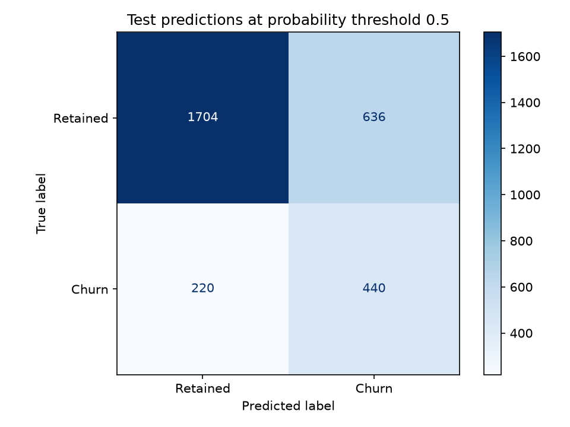
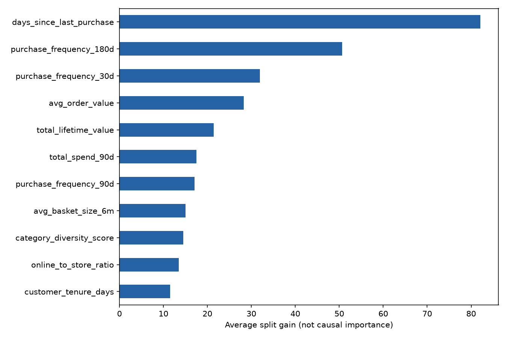

# Lab 3 Task 1: churn evaluation

## Data and provenance

This is an actual run against the restored Lab 2 Feature Store offline table in
`us-east-1`, queried through Athena under the student's IAM identity. The original
Lab 2 pipeline was rerun after its October 2 teardown. It produced the same
synthetic population; [restore log](lab3-data-restore.log) records the jobs and
complete offline verification. Training did not read the feature Parquet path or
a local CSV. Athena query ID: `d1709914-6f10-45ef-a2aa-8e9461bb290d`.

Features describe purchases through 2026-04-01; `churn_label` means no purchase in
(2026-04-01, 2026-06-30]. Query dates bound ingestion time, not the observation
window. SQL ranks each customer's versions, excludes a latest tombstone, and
orders customers deterministically before splitting. Missing numeric features
remain NaN for XGBoost's native missing-value handling; missing labels, missing
tiers, duplicate IDs and infinite inputs fail explicitly.

The Feature Group contains 13 candidate features. This model uses 11 numeric
features: it excludes the hand-written `churn_risk_score` recency heuristic and
keeps `loyalty_tier` only for slice analysis. IDs, event time and the target are
never predictors. No outcome-window features are constructed.

## Experiment design

XGBoost version: **3.2.0**. Split seed: **42**.
The stratified outer split reserves **3,000 test customers** and
uses **6,999 for training**. Each development run further
splits that training partition 80/20. Configuration and boosting-round selection
use only the inner validation AUC; the test labels are not used for early
stopping or configuration selection. The selected configuration is refitted on
all outer training rows for **154 rounds**, then evaluated once
on the outer test set. No test-seed search was performed.

All three development runs and the final run are logged to the SageMaker MLflow
**App**, not a Tracking Server. Failed development gates are retained rather than
hidden; the gate is decisive for final registration. These development scores
are inner-validation results and should not be compared as if they were test
scores:

| Experiment | Depth | Learning rate | Selected rounds | Validation AUC | Precision@10% | Recall@10% |
|---|---:|---:|---:|---:|---:|---:|
| shallow-depth3 | 3 | 0.05 | 154 | 0.7832 | 0.6929 | 0.3149 |
| balanced-depth4 | 4 | 0.1 | 38 | 0.7807 | 0.7071 | 0.3214 |
| complex-depth6 | 6 | 0.2 | 5 | 0.7791 | 0.7000 | 0.3182 |

Final run: `7f73ba1abbe44b998d7f32ed71089cf3`. Positive-class weight is the ratio of negative
to positive labels in the fit partition: **3.544805**
for the final training rows. This counteracts the roughly 22% churn prevalence.
It also means scores are useful for ranking but are not demonstrated to be
calibrated probabilities. The baseline uses only `days_since_last_purchase`,
the same training/test customers, and the same class-weight derivation. Its
fixed hyperparameters are recorded in `run-metadata.json`.

## Final held-out results

| Metric | Observed | Requirement |
|---|---:|---|
| AUC-ROC | 0.7838 | Report; no absolute threshold |
| Precision @ top 10% | 0.7233 | >= 0.50 |
| Recall @ top 10% | 0.3288 | >= 0.25 |
| Recency-only AUC | 0.7229 | Trained baseline |
| AUC improvement | +0.0609 | Positive, with CI |
| 95% CI on improvement | [0.0420, 0.0791] | Lower bound > 0 |

The contact budget selects exactly **300** customers, using descending
scores and stable customer-ID order to break ties. Precision is churners among
those contacts; recall is contacted churners divided by all test churners.
The interval uses **2,000 paired bootstrap resamples**: each
replicate scores both frozen models on exactly the same resampled test rows.
This quantifies uncertainty from the held-out customers, conditional on the
trained models; it does not include uncertainty from retraining or population
drift. A positive lower bound supports additional signal beyond recency.

The confusion matrix uses the predeclared threshold **0.5**, which
is distinct from the top-decile contact budget. Threshold calibration and
business-cost optimization are future work.

## Loyalty-tier slices

Recall uses the **same global top-decile selection** as the aggregate metric;
it is not a separately chosen top decile within each tier. A recall-gap flag
means more than 10 percentage points below overall recall. A slice is marked
too small when n < 100 or either class has fewer than 20 members; this is an
explicit caution rule, not a confidence guarantee for larger slices.

| Tier | n | Churners | AUC | Recall | Too small | Recall-gap flag |
|---|---:|---:|---:|---:|---|---|
| Bronze | 1071 | 361 | 0.7576 | 0.4543 | False | False |
| Silver | 1139 | 226 | 0.7159 | 0.1858 | False | True |
| Gold | 483 | 52 | 0.7495 | 0.1154 | False | True |
| Platinum | 307 | 21 | 0.8834 | 0.2381 | False | False |

The weakest ranking slice is **Silver** (AUC 0.7159); the
lowest contact recall is **Gold** (0.1154).
Ranking and contact allocation measure different properties: one global contact
budget can under-serve a tier even when its within-tier ranking is strong.
Any flagged gaps deserve tier-specific error review and a prospective comparison
of contact-allocation policies. Do not change thresholds on these test labels
and then report the same set as independent evidence. Small-sample warnings
above limit conclusions; even adequate sample counts do not establish fairness
or future performance. Platinum has only 21 churners, barely
above the predeclared minimum; its high AUC should therefore be interpreted
more cautiously than the larger Bronze and Silver slices.

## What the features contributed

| Feature | Average split gain |
|---|---:|
| days_since_last_purchase | 82.129 |
| purchase_frequency_180d | 50.688 |
| purchase_frequency_30d | 31.938 |
| avg_order_value | 28.296 |
| total_lifetime_value | 21.407 |
| total_spend_90d | 17.477 |
| purchase_frequency_90d | 17.110 |
| avg_basket_size_6m | 15.039 |
| category_diversity_score | 14.554 |
| online_to_store_ratio | 13.505 |
| customer_tenure_days | 11.512 |

The highest-gain features are **days_since_last_purchase, purchase_frequency_180d, purchase_frequency_30d**. The lowest-gain
features are **category_diversity_score, online_to_store_ratio, customer_tenure_days**. Gain is descriptive of this
fitted model, not causal attribution; correlated features can share or substitute
for signal. The paired baseline comparison is stronger evidence of the feature
set's collective value than any individual gain ranking. Establishing whether a
low-gain feature is dispensable would require a training-only ablation study.

## Artifacts, registration and checks

Registered package: `arn:aws:sagemaker:us-east-1:701145280839:model-package/northstar-churn-models/1`.
Approval status: **PendingManualApproval**. The portable JSON model, baseline,
holdout predictions, metrics, plots, SQL execution evidence, MLflow runs and
registry metadata are exported under `docs/lab3-evidence/`. The final numbers
must agree across the report, metrics JSON, MLflow and registry metadata.

Run the checks in [Task 1 verification instructions](lab3-task1-checks.md).
No persistent inference endpoint or SageMaker training job is needed. Full
Lab 3 submission tagging and Tasks 2-4 are separate from this Task 1 result.
